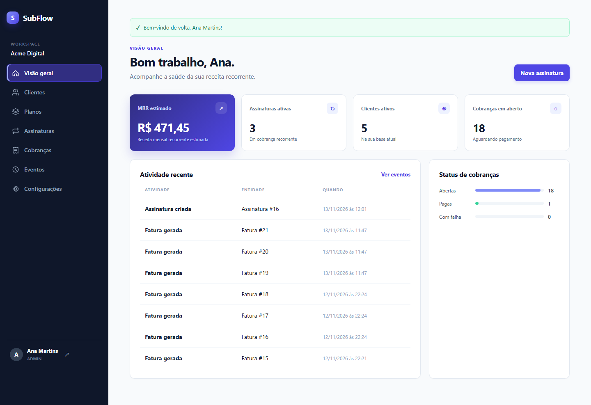
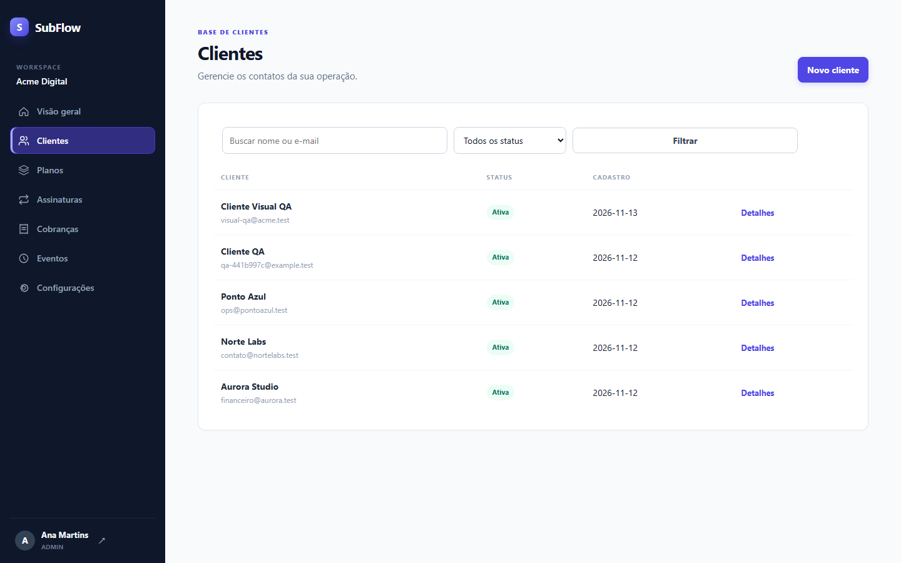
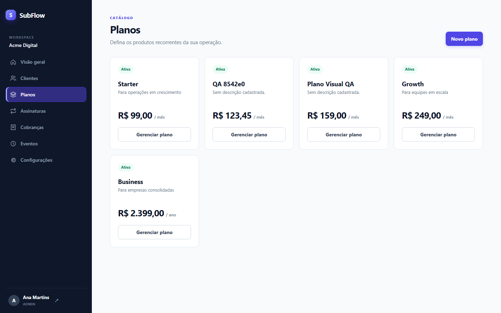
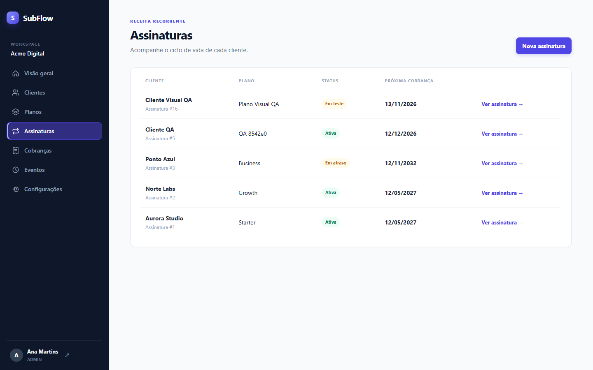
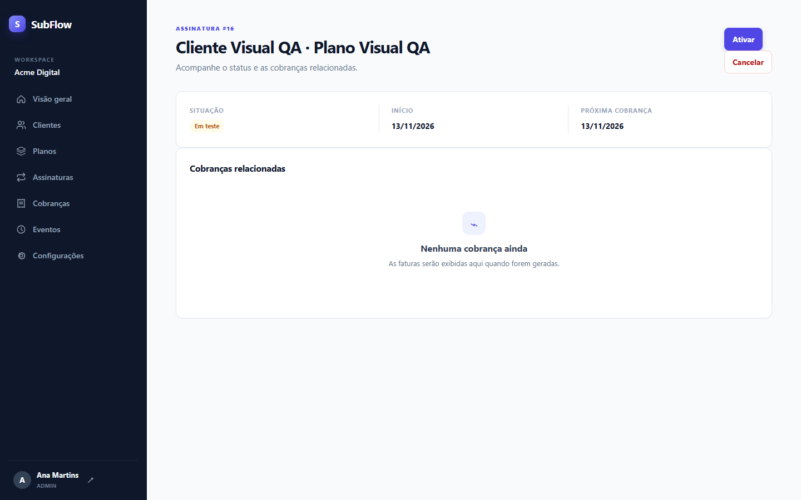
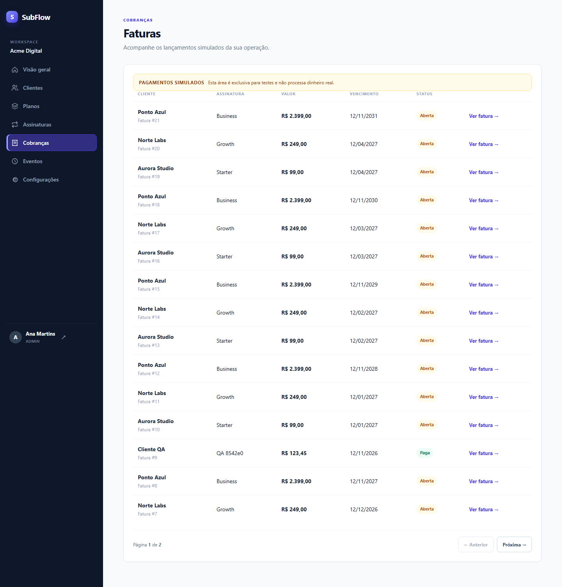
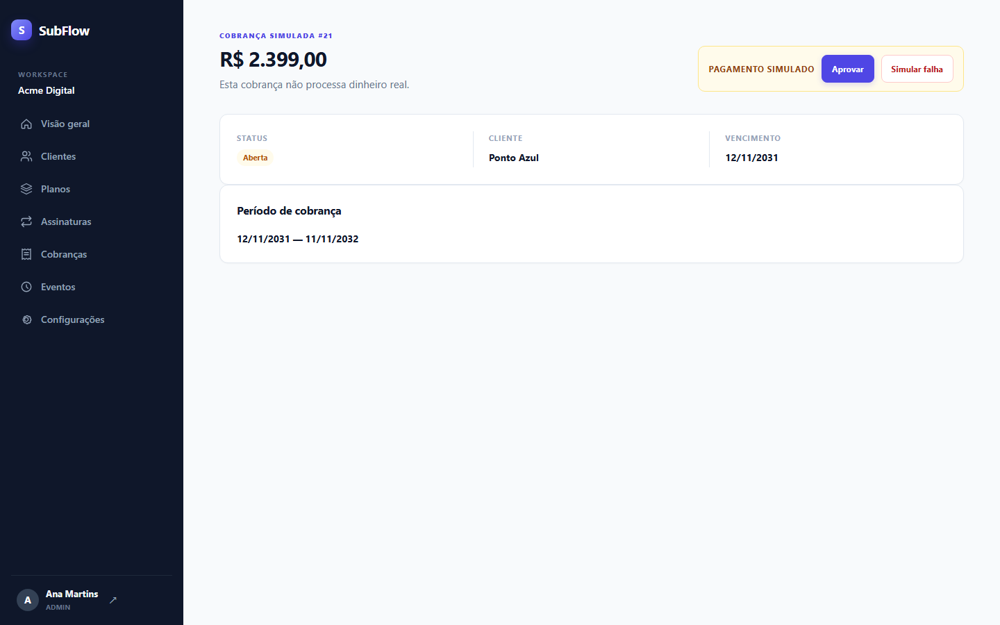
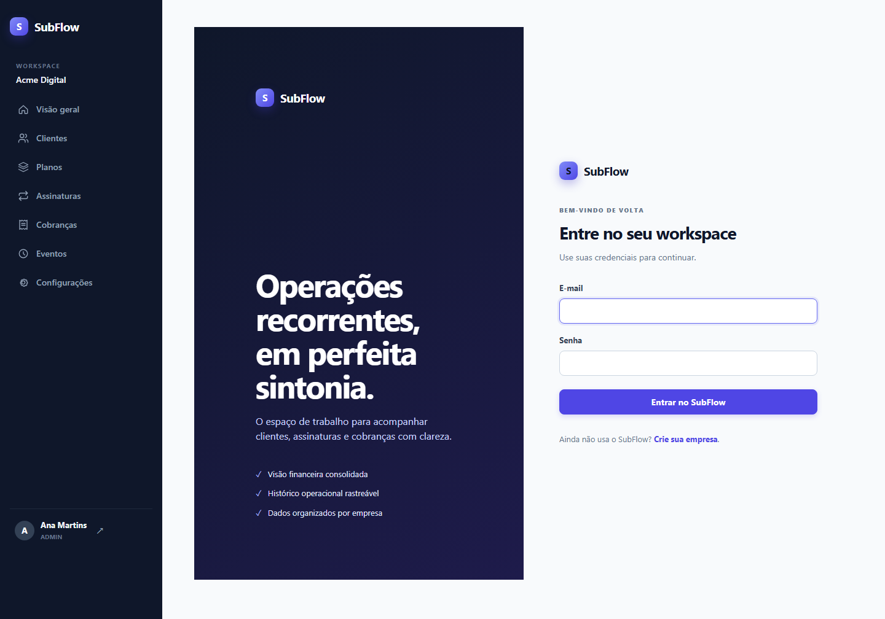
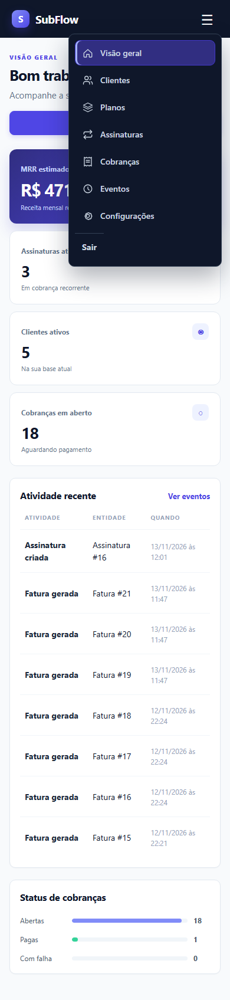

# SubFlow

[](https://github.com/caiorocha7/subflow-rails/actions/workflows/ci.yml)

SubFlow é um SaaS B2B para operar clientes, planos, assinaturas e cobranças recorrentes simuladas. A experiência administrativa reúne dados isolados por empresa, auditoria operacional e uma interface responsiva para acompanhar receita recorrente sem confundir estimativas com pagamentos reais.

> Os pagamentos deste projeto são exclusivamente simulados; nenhuma transação financeira real é processada.



## Tecnologias

Rails 8.1 · Ruby 3.3 · PostgreSQL · Redis · Sidekiq · Hotwire/Turbo · Stimulus · Tailwind CSS · RSpec · Docker Compose

## Funcionalidades principais

- Gestão de clientes, planos e assinaturas por workspace.
- Ciclo de vida de assinaturas: teste, ativação e cancelamento.
- Faturas idempotentes por assinatura e período de cobrança.
- Processamento assíncrono de eventos e pagamentos simulados.
- Auditoria, API REST autenticada, HMAC e proteção contra duplicidade.
- Permissões ADMIN/MEMBER, isolamento multi-tenant e interface responsiva.

## Galeria

<p align="center">
  
  
</p>
<p align="center">
  
  
</p>
<p align="center">
  
  
</p>
<p align="center">
  
  
</p>

## Arquitetura

O SubFlow é um monólito modular Rails. Controllers aplicam autenticação e escopo da conta atual; services encapsulam transições de assinatura, geração de cobrança e processamento de eventos. PostgreSQL é a fonte de verdade e Redis/Sidekiq executam trabalhos assíncronos.

```text
Web / API → Controllers → Services → PostgreSQL
                         ↘ Sidekiq / Redis → processamento assíncrono
```

## Cobrança e idempotência

Cada fatura tem índice único em `(subscription_id, period_start)`. A geração ocorre em transação e com lock, evitando cobranças duplicadas. Eventos de pagamento possuem `event_id` único; o webhook verifica HMAC/timestamp e o job de processamento é idempotente.

O MRR exibido é uma estimativa de receita recorrente a partir das assinaturas ativas — não é dinheiro efetivamente recebido.

## Segurança e multi-tenancy

- Recursos web são consultados a partir de `current_account`.
- A API identifica a empresa pelo Bearer token, sem aceitar `account_id` externo.
- ADMIN altera a operação; MEMBER mantém apenas o acesso permitido.
- Webhooks validam assinatura HMAC e rejeitam duplicatas.
- Tokens e chaves locais não são versionados; use o `.env.example` apenas como referência.

## Executar com Docker

1. Inicie o Docker Desktop.
2. Suba os serviços:

   ```bash
   docker compose up --build
   ```

3. Em outro terminal, prepare dados locais fictícios:

   ```bash
   docker compose exec web bin/rails db:seed
   ```

4. Abra [http://localhost:3000](http://localhost:3000).

## Testes e qualidade

```bash
docker compose exec -e RAILS_ENV=test web bin/rails db:prepare
docker compose exec -e RAILS_ENV=test web bundle exec rspec
docker compose exec web bundle exec rubocop
docker compose exec web bundle exec brakeman -q
```

## Documentação técnica

- [Arquitetura](docs/ARCHITECTURE.md)
- [Banco de dados](docs/DATABASE.md)
- [API](docs/API.md)
- [Decisões](docs/DECISIONS.md)

## Limitações

- Pagamentos e notificações são deliberadamente simulados.
- Não há integração com gateway financeiro real.
- A paginação administrativa está disponível na listagem de faturas; as demais listas preservam o escopo apropriado para o MVP.
